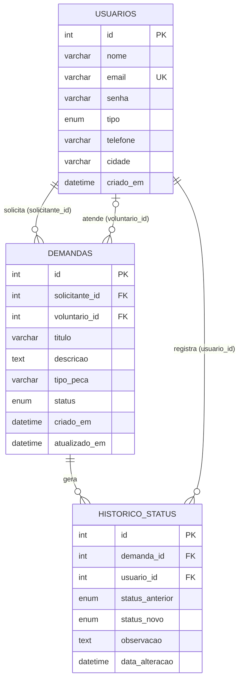

# Estrutura do banco de dados — Conecta3D

Banco: `oficinahotrods_joaodavi_banco_projeto` (MySQL/MariaDB)

## Diagrama entidade-relacionamento

## Tabelas

### `usuarios`
Guarda todos os usuários do sistema — solicitantes, clínicas, voluntários e
administradores — diferenciados pela coluna `tipo`
(`solicitante`, `clinica`, `voluntario`, `admin`).

| Coluna | Tipo | Observação |
|---|---|---|
| `id` | INT, PK | |
| `nome` | VARCHAR(150) | |
| `email` | VARCHAR(150) | único |
| `senha` | VARCHAR(255) | hash gerado por `password_hash()` |
| `tipo` | ENUM | solicitante, clinica, voluntario, admin |
| `telefone` | VARCHAR(20) | opcional |
| `cidade` | VARCHAR(100) | opcional |
| `criado_em` | DATETIME | preenchido automaticamente |

### `demandas`
Cada pedido de peça 3D feito por um solicitante/clínica, opcionalmente
associado a um voluntário que se disponibilizou a imprimir.

| Coluna | Tipo | Observação |
|---|---|---|
| `id` | INT, PK | |
| `solicitante_id` | INT, FK → usuarios.id | obrigatório, `ON DELETE RESTRICT` |
| `voluntario_id` | INT, FK → usuarios.id | opcional, `ON DELETE SET NULL` |
| `titulo` | VARCHAR(150) | |
| `descricao` | TEXT | |
| `tipo_peca` | VARCHAR(100) | opcional |
| `status` | ENUM | aberta, em_andamento, concluida, cancelada |
| `criado_em` | DATETIME | |
| `atualizado_em` | DATETIME | atualizado automaticamente a cada mudança |

### `historico_status`
Registro de auditoria: cada mudança de status de uma demanda, quem fez e
quando.

| Coluna | Tipo | Observação |
|---|---|---|
| `id` | INT, PK | |
| `demanda_id` | INT, FK → demandas.id | `ON DELETE CASCADE` |
| `usuario_id` | INT, FK → usuarios.id | quem realizou a alteração |
| `status_anterior` | ENUM, opcional | nulo no primeiro registro (criação) |
| `status_novo` | ENUM | |
| `observacao` | TEXT | opcional |
| `data_alteracao` | DATETIME | |

## Regras de integridade

- Um solicitante não pode ser removido enquanto tiver demandas associadas
  (`RESTRICT`) — preserva o histórico.
- Remover um voluntário não apaga as demandas que ele atendeu; elas apenas
  ficam sem voluntário associado (`SET NULL`).
- Excluir uma demanda remove automaticamente todo o seu histórico de status
  (`CASCADE`) — é o mecanismo por trás do botão "Excluir demanda
  permanentemente" disponível para o administrador.
